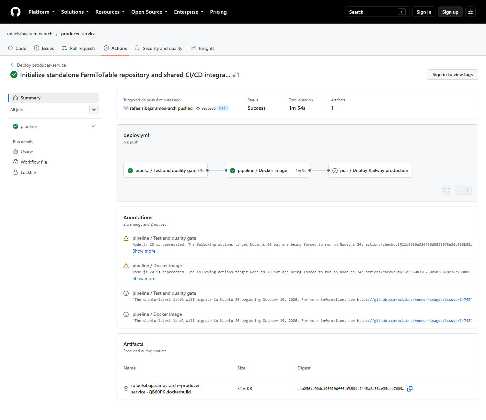
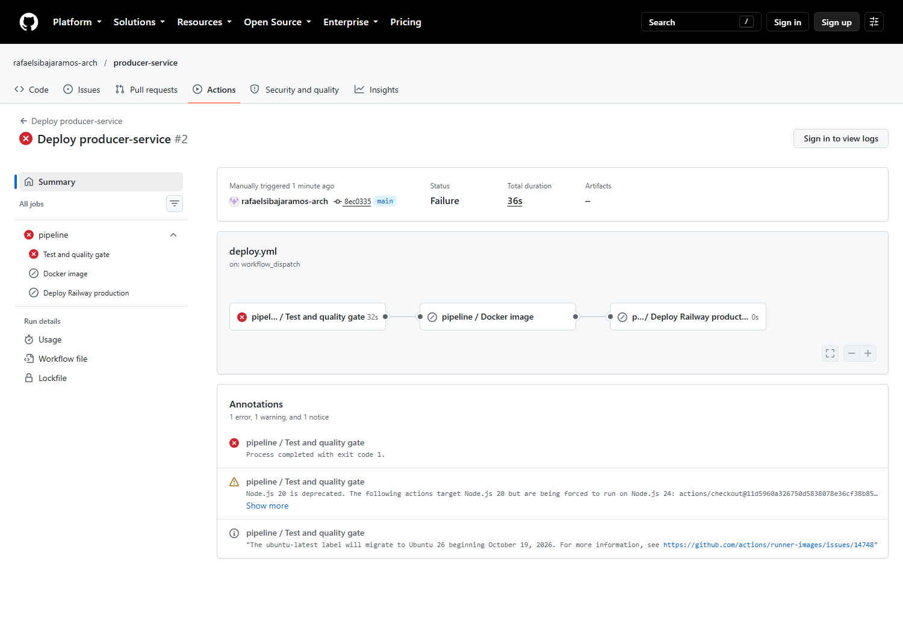

# Evidencias de ejecución

Las ejecuciones iniciales aprobaron pruebas y construcción/publicación Docker. El job deploy estaba deshabilitado durante esa validación inicial; estos enlaces no se presentan como prueba de despliegue.

| Microservicio | Ejecución inicial exitosa |
| --- | --- |
| producer | https://github.com/rafaelsibajaramos-arch/producer-service/actions/runs/40601839213 |
| catalog | https://github.com/rafaelsibajaramos-arch/catalog-service/actions/runs/40601851566 |
| identity | https://github.com/rafaelsibajaramos-arch/identity-service/actions/runs/40602096026 |
| inventory | https://github.com/rafaelsibajaramos-arch/inventory-service/actions/runs/40602111341 |
| order | https://github.com/rafaelsibajaramos-arch/order-service/actions/runs/40602118260 |
| payment | https://github.com/rafaelsibajaramos-arch/payment-service/actions/runs/40602128564 |
| logistics | https://github.com/rafaelsibajaramos-arch/logistics-service/actions/runs/40602139019 |
| notification | https://github.com/rafaelsibajaramos-arch/notification-service/actions/runs/40602146701 |
| analytics | https://github.com/rafaelsibajaramos-arch/analytics-service/actions/runs/40602158555 |

## Falla controlada

[Ejecución real con aserción intencionalmente incorrecta](https://github.com/rafaelsibajaramos-arch/producer-service/actions/runs/40602412882): Test falló; Docker y Deploy quedaron omitidos por sus dependencias. No se modificó código de negocio.

## Capturas

## Producción

El token de proyecto se validó y se configuró como secreto cifrado en los nueve repositorios. La conexión y las ejecuciones completas de despliegue se verifican por separado en Actions; se registrarán sus resultados una vez finalizadas.

La reflexión del equipo está en [INFORME_REFLEXION.md](INFORME_REFLEXION.md). Completar los integrantes reales antes de entregar.
